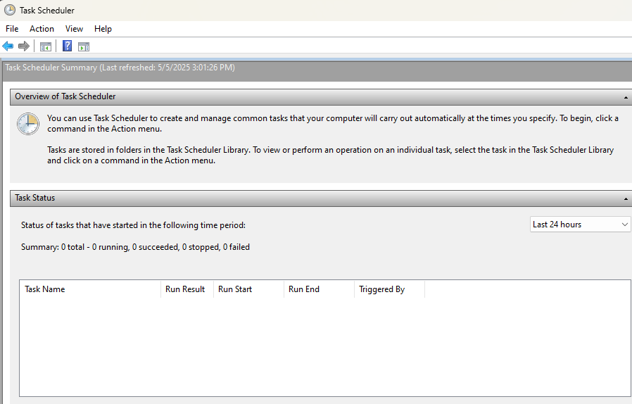

# Deltard

Unattended timecard automation for sites behind MFA — including the kind that
demands a 6-digit code off a physical RSA SecurID fob that no API can reach.

A webcam watches the token. A computer vision model reads the digits. Playwright
drives a real Chrome through the login gauntlet and fills the timesheet. If
anything breaks, your phone buzzes.

## What's actually reusable here

The Unanet support is a worked example, not the point. Two pieces are general:

**1. The RSA token reader** (`rsa_reader/`, `models/`) — a three-stage YOLO
pipeline that turns a webcam frame into a 6-digit code: locate the token screen,
de-skew it via segmentation, then detect the digits on the canonical crop. It
publishes a code only when 8 of the last 10 frames agree, so failures surface as
timeouts rather than as wrong codes. This works for any workflow that needs a
hardware token read programmatically, not just timecards.

**2. The login state machine** (`unanet/login.py`) — federated SSO isn't a
linear script. Microsoft may redirect to your IdP or not, MFA may be prompted or
skipped, "Stay signed in?" may appear or not, and a persistent browser profile
changes which steps happen at all. So instead of a fixed sequence, each page
state gets a *detector* and a *handler*, and a loop runs whatever matches until
you land on the target host. Adding a step your tenant has and mine doesn't is
one entry in a dict.

The site-specific part — finding the right row in a timesheet grid and filling
it — lives in `unanet/timesheet.py` and is the part you'd replace.

## How the pieces fit

```
run_unanet.py            entry point: launch Chrome, log in, fill, notify
├── unanet/config.py     merges config.yaml (settings) + secrets.env (creds)
├── unanet/login.py      the SSO state machine  ← reusable
│   └── get_token_code.py
│       └── rsa_reader/  webcam → 6-digit code  ← reusable
├── unanet/timesheet.py  site-specific: find the row, fill the days, save
└── unanet/notify.py     ntfy / email alerts + dead-man's-switch ping
```

`handlers/` and `main.py` are an earlier Deltek Costpoint / ADFS implementation,
kept as a reference for what a second site module looks like.

## Roadmap for a new user

**If your employer uses Unanet**, follow *Setup* below and you may only need to
change config values.

**If your employer uses something else**, the path is:

1. Get the hardware rig working and confirm the token reader reads your fob
   (*Setup* steps 1–2, then `python -c "from get_token_code import get_token_code; print(get_token_code())"`).
2. **Map your site's flow** with Claude — the section below walks through this.
   You end up with a `docs/flow_map.md` full of real selectors.
3. Add any login states your tenant has that this one doesn't (Duo, a factor
   picker, a device-trust prompt) to the state machine.
4. Write your own `timesheet.py` equivalent against your site's grid.
5. Wire up notifications and schedule it.

Steps 3 and 4 are the ones people expect to be hard. They mostly aren't, *if*
step 2 gave you accurate selectors — which is what the next section is for.

## Mapping your site's flow with Claude

The most reliable approach is to walk through the flow once in a real browser
while Claude records the DOM at every step.

### Install the tools

1. **Claude Code** — the CLI/desktop app that edits this repo.
   See [claude.com/claude-code](https://claude.com/claude-code).
2. **Claude in Chrome** — the extension that lets Claude see and drive your
   real browser:
   [install from the Chrome Web Store](https://chromewebstore.google.com/detail/fcoeoabgfenejglbffodgkkbkcdhcgfn).
3. Open the Claude side panel in Chrome and **sign in with the same account**
   you use in Claude Code. This trips people up — a different account means the
   extension never connects.
4. Restart Chrome. The extension sometimes doesn't announce itself until a
   fresh launch.

Why the extension rather than a throwaway automation browser: it uses *your*
Chrome, with your real profile, extensions, and fingerprint. What Claude sees is
what your login actually does, including any device-trust state.

### Do the walkthrough

Open Claude Code in this repo and prompt it something like:

> I need to map the login and timecard flow for a new site so we can automate
> it. Open `<your timecard URL>` in my Chrome via the Claude in Chrome
> extension. I'll drive — I'll enter my own credentials and MFA codes, you never
> type them. After each page loads I'll tell you to capture; snapshot the page
> and record the stable selectors (prefer `name` and `data-*` attributes over
> auto-generated ids), the URL, and anything conditional. When we reach the
> timesheet, capture the grid structure: how rows and day cells are named, and
> how a cell maps to a date. Write it all to `docs/flow_map.md`.

Then click through your own login while narrating. A few things worth doing:

- **Say when a page is conditional.** "This MFA screen only shows up on a new
  device" tells Claude to make that handler optional rather than required.
- **Show both branches.** If a fresh period needs a timesheet *created* first,
  walk that path too, then go back and do the normal one.
- **Never type credentials into the chat.** Claude will point you at
  `secrets.env`; put them there. It reads them at runtime and never needs to see
  them.

### Then have Claude build against it

With the map written, ask Claude to add the states it found and write the site module. 
Two conventions to keep:

- A **detector** answers "is the page in this state?" and must never throw —
  return `False` if the element is missing. A **handler** acts on that state.
  Register the pair in `_HANDLERS` and `_detect()`.
- **Key on stable markup.** Okta regenerates element ids on every render, so
  this code matches on `input[name="credentials.passcode"]` and
  `h2[data-se="o-form-head"]`. Never key on the hostname either — that's
  tenant-specific.

A worthwhile prompt once it runs: *"review the login state machine for states
that could hang or retry a rejected credential."* Repeated auth failures are far
more likely to lock your account than anything else this script does.

# Setup

## Hardware needed

* A decent quality webcam (4k recommended) ([the one I use](https://www.amazon.com/dp/B0CJHZ92P6))
* Something to hold both the webcam and the token still
  ([a chemistry stand](https://www.amazon.com/dp/B0CF5NY4W4) works well)

Plug the webcam in and make sure it has a good view of the token. On Windows,
the Camera app shows you the current view.


***IMPORTANT***: make sure the token is well lit *at the hour you schedule the
run*. Bad lighting is the most common cause of failure — a rig that reads
perfectly at noon may see nothing at 6am. The token also has to be still; the
reader needs several agreeing frames.

## 1. Install

Assumes Python is already installed; if not, get it from
[python.org](https://www.python.org/downloads/).

Clone rather than download, so you can pull updates:

```bash
git clone https://github.com/anontractor/Deltard.git
```

Then double-click `setup.bat` (Windows). It creates a virtual environment and
installs dependencies. You'll also need Chrome installed — the automation drives
your real Chrome, not a bundled browser.

## 2. Configure

Settings are split so that secrets never land in a file you might commit:

* `config-template.yaml` → rename to **`config.yaml`**. Site URL, which
  timesheet row to fill, holidays, notification channel, and the reader's
  camera/model settings.
* `secrets.env-template` → rename to **`secrets.env`**. Login, password, RSA
  PIN, notification tokens. Gitignored — never commit it.

Verify the reader before going further:

```bash
venv\Scripts\python.exe -c "from get_token_code import get_token_code; print(get_token_code())"
```

If that prints the digits currently on your fob, the hard part works.

## 3. Set up failure notifications

It runs unattended, so it has to be able to tell you when it breaks. Pick a
channel in `config.yaml` under `NOTIFY`:

* **ntfy** (default): install the [ntfy app](https://ntfy.sh/) on your phone,
  invent a long random topic name, subscribe to it, and put the same string in
  `NTFY_TOPIC` in `secrets.env`. No account needed. The topic name is the *only*
  access control — anyone who knows it can read your alerts, so make it
  unguessable.
* **email**: set `channel: email`, fill in `NOTIFY.email.to`, and put your
  address plus a [Google App Password](https://myaccount.google.com/apppasswords)
  in `SMTP_USER` / `SMTP_PASSWORD`.

Alerts are deliberately content-free — "Autofill automation FAILED", nothing
more. Diagnostics stay local in `automation.log` and `last_failure.png`. Test
each of the three before relying on them:

```bash
venv\Scripts\python.exe run_unanet.py --test-notify
```

```bash
venv\Scripts\python.exe run_unanet.py --test-notify fail
```

```bash
venv\Scripts\python.exe run_unanet.py --test-notify final
```

Success notifications are on by default, which is deliberate: if you get one
every workday, a *missing* one is itself the alert.

**The submit reminder** (`remind_on_final_weekday`) is the third alert and the
one that saves you. This script fills and saves but **never submits** — clicking
Submit sends the timesheet to your approver, and no automation should do that on
your behalf. So on the period's last working day it sends a high-priority
"action needed" alert instead of the routine OK ping. That day is computed by
walking back from the period end past weekends and any configured `HOLIDAYS`, so
a period ending on a weekend, or on a holiday Friday, still lands on the right
day.

Note this only fires if the script actually runs that day. Pair it with
`HEALTHCHECK_URL` below so a missed run is caught independently.

Optionally set `HEALTHCHECK_URL` to a [healthchecks.io](https://healthchecks.io/)
ping URL. The script pings on success and failure, and the service alerts you if
a run never happens at all — the asleep machine, the disabled task, the broken
venv. That's the one failure no in-script notifier can report, and for something
that fails by *omission* it's the case that actually costs you.

## 4. Schedule it

First, **run it once by hand** (`run.bat`). The first run does the full login and
warms the persistent Chrome profile in `browser_profile/`; later runs usually
reuse that session and skip most of the login.

Then, in Windows Task Scheduler:

**A.** Press Windows and type Task Scheduler. Open it.



**B.** Action → Create task. Name it, and decide whether it should run while
you're logged off (recommended). No elevated privileges required.

**C. Trigger** — Triggers tab → New. Choose **Weekly** (not Daily) and tick
Monday–Friday. Daily has no day-of-week filter, so it's the usual reason a task
fires on a Sunday. Checking "Delay task for up to" varies the actual run time,
which also avoids hammering the site at a predictable second.

Belt and braces: the script also exits immediately on Sat/Sun before opening a
browser, so a misconfigured trigger costs nothing. Override with `--force`, or
set `RUN_ON_WEEKENDS: true` if you'd rather weekend runs backfill the week.

**D. Action** — Actions tab → New → "Start a program".
* Program/script: the *entire* path to `run.bat`
* Start in: the same path minus `run.bat`

For a clone on your desktop:
Program/script `C:/Users/<you>/Desktop/Deltard/run.bat`,
Start in `C:/Users/<you>/Desktop/Deltard/`

**E. Conditions** (recommended) — start only if the computer has been idle 10+
minutes, and wake the computer to run.

Mind your site's lock windows. Many timecard systems lock entry during a weekly
labor-processing window, and a run scheduled inside it will fill cells but fail
to save. Check your site's posted schedule before picking a run time.

## Troubleshooting

| Symptom | Where to look |
|---|---|
| Token read times out | Lighting at the scheduled hour; token must be still; check the rig hasn't shifted |
| Login hangs on a new screen | `last_failure.png` — likely a page state with no handler; add a detector/handler pair |
| Cells fill but don't save | Site lock window, or the save didn't verify — check `automation.log` |
| No alerts arriving | `--test-notify`; a topic mismatch still returns success from ntfy |
| Every run does a full login | Profile isn't persisting — check `browser_profile/` exists and is writable |

Full run history is in `automation.log`. Note that this log is *not* sanitized
for sharing.

## Repo layout

```
run_unanet.py        entry point
get_token_code.py    token reader façade
unanet/              config, login state machine, timesheet, notifications
rsa_reader/          CV pipeline (vendored from its training repo)
models/              YOLO weights: screen detect, segment, digit detect
docs/flow_map.md     captured selector map — the reference for the above
handlers/, main.py   earlier Costpoint/ADFS implementation, for reference
config.yaml          your settings (gitignored)
secrets.env          your credentials (gitignored)
```
